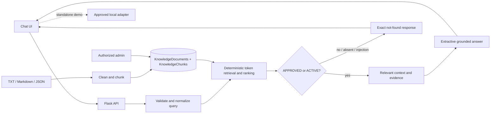

# Zynora Architecture

## Runtime components

- `src/app/App.tsx`: view state, local persistence, conversation workflow, and adapter selection.
- `src/services/mockZynoraClient.ts`: standalone deterministic retrieval using only seeded approved records.
- `src/services/httpZynoraClient.ts`: API contract client enabled with `VITE_API_BASE_URL`.
- `backend/routes/chat.py`: health and chat endpoints.
- `backend/services/retrieval.py`: injection detection, tokenization, status filtering, scoring, evidence, and exact fallback.
- `backend/services/ingestion.py`: extension/size/UTF-8 validation, JSON required-field validation, Markdown heading cleanup, and bounded chunking.
- `backend/routes/admin.py`: authorized document search, CRUD, upload ingestion, lifecycle transitions, reindexing, and audit events.
- `backend/auth.py`: signed session decoding, user provisioning, active-user checks, and admin RBAC.
- `database/schema.sql`: MySQL-compatible persistence model for knowledge, chunks, users, chat history, and audits.

## Trust boundary

Only content deliberately inserted by an authorized admin or the internal seed scripts can reach the knowledge store. Retrieval never calls a URL, search engine, external model, or external website. The answer is formed from the selected document content and includes the selected source metadata. When retrieval has no sufficiently relevant approved context, Zynora does not guess.

## Knowledge lifecycle

`DRAFT → APPROVED → ACTIVE → ARCHIVED`. Only APPROVED and ACTIVE records are eligible for retrieval. Archived records remain available to administrators for audit/history but are excluded from the answer path.
